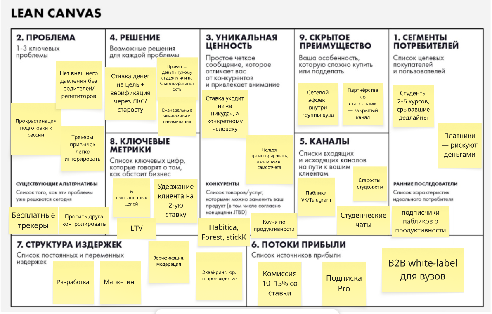
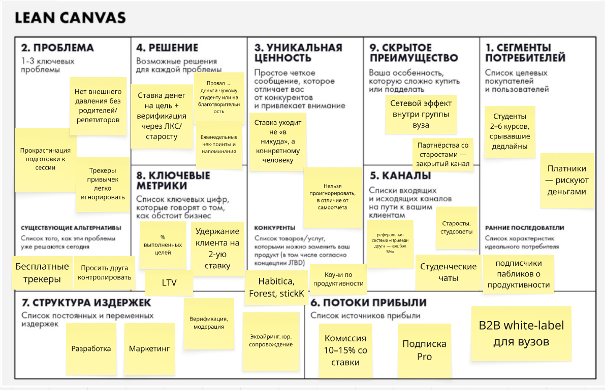

# ДЗ 1. Lean Canvas и Elevator Pitch
 
## Бизнес-модель
 
**Стартап · C2C/B2B2C · EdTech · Mobile + Web**
*(сервис, где студенты «бьются об заклад» на выполнение учебных целей)*
 
## Продукт: «Долг.Себе»
 
Эскроу-сервис для учебных обещаний: студент ставит деньги на свою цель и теряет их в пользу незнакомца или на благотворительность при провале.
 
---
 
## Elevator Pitch
 
Каждую сессию тысячи студентов заваливают экзамены не из-за незнания, а из-за отсутствия внешнего давления. Мы предоставляем эскроу-платформу, где студент ставит реальные деньги на учебную цель и теряет их при провале - в пользу случайного незнакомца или на благотворительность, в отличие от трекеров привычек, где «проигрыш» ничего не стоит. В результате completion rate по целям в разы выше, а мы зарабатываем комиссию с каждой ставки. Сейчас собираем первую группу для пилота — хотите посмотреть MVP?
 
---
 
## Lean Canvas
 

 
---
 
# ДЗ 2. Product Discovery
 
## 1. HADI-гипотеза
 
**Самый критичный риск:** риск ценности (Value risk) — готовы ли студенты реально ставить свои деньги на кон, или это слишком стрессово, и они предпочтут бесплатные трекеры без финансового риска.
 
- **H (Гипотеза):** Мы верим, что студенты готовы поставить от 500 до 2000 руб. на выполнение учебной цели при условии, что деньги при провале уходят конкретному незнакомцу, а не «сгорают» абстрактно
- **A (Действие):** Делаем Fake Door — лендинг с конкретным предложением «поставь 1000 руб. на сдачу сессии без хвостов» и кнопкой «Создать ставку», запускаем таргет в студенческих пабликах VK на бюджет 5000 руб.
- **D (Данные):** Замеряем цену клика, конверсию в клик «Создать ставку», конверсию в intent-to-pay (ввод данных карты)
- **I (Вывод):** Если получаем 50+ заявок с конверсией в intent-to-pay выше 15% при цене лида ниже 300 руб. — гипотеза подтверждена. Если нет — отказываемся от механики «ставка незнакомцу» и тестируем более мягкий вариант (ставка на благотворительность)
## 2. Юнит-экономика
 
**Юнит:** одна совершённая платная ставка (сделка с комиссией)
 
### Воронка и CAC
| Этап | Значение |
|---|---|
| Клик в рекламе (паблики VK) | 15 руб./клик, пришло 2000 человек = 30 000 руб. |
| Конверсия в создание цели | 8% → 160 лидов, цена лида ≈ 187,5 руб. |
| Конверсия в оплату (ставка + карта) | 25% → 40 платящих клиентов |
| **CAC (маркетинг)** | 30 000 / 40 = **750 руб.** |
| + верификация, модерация на клиента | +100 руб. |
| **Итоговый CAC** | **≈ 850 руб.** |
 
### LTV
- Средний размер ставки: 1500 руб.
- Комиссия сервиса: 12% → 180 руб. чистой прибыли со сделки
- Частота: 2 ставки в год (зимняя/летняя сессия), активен в среднем 2 года → 4 ставки за lifetime
- **LTV = 180 × 4 = 720 руб.**
### Сходимость экономики
**LTV (720 руб.) < CAC (850 руб.)** → краш-тест провален. При масштабировании через платный трафик бизнес будет генерировать убытки на каждом юните.
 
## 3. План Б (Pivot)
 
Поскольку базовая экономика не сошлась, закладываем два пивота как план Б:
 
- **Engine of Growth Pivot** (смена драйвера роста): переход от покупки трафика к виральности по механике Dropbox — «Пригласи друга на ставку — оба получите кэшбэк 5% от следующей ставки». Это может опустить CAC в разы, почти до нуля на реферальных пользователях, и развернуть неравенство LTV/CAC в прибыльную сторону
- **Channel Pivot** (смена канала): отказ от платного таргета в пользу партнёрств со старостами и студсоветами (реферальная механика «скидка группе») — бесплатный канал вместо CAC через рекламу
Если на этапе пилота экономика всё же сойдётся без доработок — тот же Engine of Growth Pivot закладываем заранее как резервный план на случай удорожания трафика при масштабировании.
 
## Lean Canvas после Pivot
 
В блок «Каналы» добавлена реферальная механика «Приведи друга — кэшбэк 5%» вместо платного трафика как основного канала.
 

 
---
 
# ДЗ 3. Требования и приоритизация
 
## 1. Роли и User Stories
 
**Роли:** Студент (создаёт ставку) · Куратор/Староста (верифицирует) · Получатель компенсации (случайный студент) · Администратор вуза (B2B)
 
| № | История (Как... я хочу... чтобы...) |
|---|---|
| 1 | Как студент, я хочу зарегистрироваться через студенческую почту (.edu), чтобы подтвердить принадлежность к вузу |
| 2 | Как студент, я хочу создать учебную цель с конкретным сроком, чтобы зафиксировать обязательство |
| 3 | Как студент, я хочу выбрать сумму ставки 500–5000 руб., чтобы соотнести риск с бюджетом |
| 4 | Как студент, я хочу привязать карту для списания ставки, чтобы деньги заморозились на эскроу |
| 5 | Как студент, я хочу выбрать куратора из своей группы, чтобы подтверждение было объективным |
| 6 | Как студент, я хочу получать еженедельные напоминания, чтобы не забыть об обязательстве |
| 7 | Как куратор, я хочу подтвердить или отклонить выполнение цели, чтобы деньги распределились корректно |
| 8 | Как студент, я хочу получить ставку обратно при успехе, чтобы почувствовать справедливость системы |
| 9 | Как студент, я хочу заранее выбрать получателя при провале — незнакомца или благотворительность |
| 10 | Как получатель компенсации, я хочу получить уведомление и деньги при чужом провале |
| 11 | Как студент, я хочу видеть публичный статус моих ставок в чате группы для доп. давления |
| 12 | Как студент, я хочу пригласить друга и получить кэшбэк 5%, чтобы снизить стоимость участия |
| 13 | Как студент, я хочу оспорить решение куратора через поддержку, если оно ошибочно |
| 14 | Как студент, я хочу оформить подписку Pro для расширенной аналитики прогресса |
| 15 | Как администратор вуза, я хочу видеть агрегированную статистику по группе для мотивации на стипендию |
| 16 | Как студент, я хочу удалить аккаунт и вывести остаток средств |
 
## 2. Приоритизация (RICE)
 
Шкала 1–3 по каждому параметру. Score = R × I × C / E
 
| № | История | R | I | C | E | Score |
|---|---|---|---|---|---|---|
| 2 | Создание цели со сроком | 3 | 3 | 3 | 1 | **27** |
| 3 | Выбор суммы ставки | 3 | 3 | 3 | 1 | **27** |
| 8 | Возврат ставки при успехе | 3 | 3 | 3 | 1 | **27** |
| 1 | Регистрация через .edu | 3 | 2 | 3 | 1 | 18 |
| 5 | Выбор куратора | 3 | 3 | 2 | 2 | 9 |
| 7 | Куратор подтверждает/отклоняет | 3 | 3 | 2 | 2 | 9 |
| 9 | Распределение денег при провале | 3 | 3 | 2 | 2 | 9 |
| 10 | Уведомление получателю | 2 | 2 | 2 | 1 | 8 |
| 4 | Привязка карты / эскроу | 3 | 3 | 2 | 3 | 6 |
| 16 | Удаление аккаунта / вывод средств | 2 | 1 | 3 | 1 | 6 |
| 6 | Еженедельные напоминания | 2 | 1 | 2 | 1 | 4 |
| 11 | Публичный статус в чате | 2 | 2 | 1 | 1 | 4 |
| 12 | Реферальная система | 2 | 2 | 1 | 2 | 2 |
| 13 | Оспаривание решения | 1 | 2 | 2 | 2 | 2 |
| 15 | B2B аналитика для вуза | 1 | 2 | 1 | 3 | 0,67 |
| 14 | Подписка Pro | 1 | 1 | 1 | 2 | 0,5 |
 
## 3. MVP и MLP
 
**MVP (скелет — без этого продукт не работает):**
Истории 1, 2, 3, 4, 5, 7, 8, 9 — полный цикл ставки: регистрация → создание цели → оплата/эскроу → верификация куратором → возврат или распределение денег.
 
**MLP (вау-эффект и удобство):**
Истории 6, 10, 11, 12, 13, 14, 15, 16 — напоминания, публичный статус, реферальная система, оспаривание, подписка Pro, B2B-аналитика, самостоятельное управление аккаунтом.
 
## 4. Детализация требований для 2 главных историй MVP
 
### История 2 — «Создание учебной цели со сроком и суммой ставки»
 
**Функциональные требования (ФТ):**
- Я могу выбрать категорию цели из предустановленного списка (сдать сессию, сдать конкретный экзамен, выполнить план по лекциям)
- Я могу указать точную дату дедлайна
- Я могу выбрать сумму ставки в диапазоне 500–5000 руб.
- Я могу выбрать куратора из списка подтверждённых кураторов моей группы
- Я могу увидеть итоговые условия (сумма, срок, куратор, получатель при провале) перед подтверждением
**Нефункциональные требования (НФТ):**
- Форма создания цели должна загружаться не дольше 2 секунд
- Черновик цели должен сохраняться локально при обрыве соединения
- Интерфейс должен быть адаптирован под мобильные устройства
- Список кураторов подгружается только для вуза/группы текущего пользователя (защита данных)
- Платформа должна выдерживать 1000+ одновременных созданий ставок в пиковый период (начало сессии)
### История 9 — «Распределение денег при провале цели»
 
**Функциональные требования (ФТ):**
- Я могу заранее выбрать получателя при провале — случайного студента или благотворительный фонд
- Система должна автоматически фиксировать провал по истечении срока без ответа куратора (эскалация по таймауту)
- Я могу получить уведомление об исходе ставки не позднее 24 часов после дедлайна
- Я могу оспорить решение через обращение в поддержку в течение 48 часов
**Нефункциональные требования (НФТ):**
- Перевод средств должен завершаться не дольше 5 минут после подтверждения исхода
- Все денежные операции логируются для аудита (эскроу-операции, 115-ФЗ)
- Персональные и платёжные данные защищены согласно 152-ФЗ и стандарту PCI DSS
- Уведомления дублируются через push и email одновременно (резервирование канала доставки)